# EduPulse

[](https://github.com/jaswantraj969/edupulse/actions/workflows/ci.yml)
[](LICENSE)

EduPulse is a school management platform — students, teachers, staff, classes, daily
attendance and grades — with an **explainable early-warning module** that helps staff notice,
after the first term, which students may be heading towards failing the year.

The early warning is **decision support**: every score comes with its reasons in plain language,
a visible reminder to review it with the student's context, and an audit trail. It is never an
automatic sanction.

## At a glance

- **Stack:** FastAPI + SQLAlchemy 2 + PostgreSQL 16 · React 19 + TypeScript + Vite + Tailwind ·
  scikit-learn · Docker Compose · GitHub Actions (lint, types, tests, e2e with axe, ML
  reproduction, dependency audit).
- **Early warning:** logistic regression on the UCI Student Performance data, scored per
  (student, subject) after Term 1. Held-out test (scored once): **average precision 0.845**
  [95 % CI 0.740–0.924], ROC AUC 0.953 [0.924–0.977]; at the high-risk threshold recall 0.891
  [0.792–0.976], precision 0.651 [0.527–0.767]. Cross-validated AP 0.769 ± 0.062 vs 0.220 for a
  dummy baseline.
- **Honest finding:** the Term 1 grade carries 99.2 % of the permutation importance; without any
  grade (failures only) test AP falls to 0.414 [0.290–0.565].
- **Demo data is synthetic**; the model must be re-validated on local data before real use.

> **What the early warning really is.** The first-term grade carries almost all of the predictive signal (99.2 % of the deployed model's permutation importance on the test set). Without any grade the model is weak: a model using only previous failures reaches a test average precision of 0.414 [95 % CI 0.290, 0.565] and, at the 80 % recall target, flags every student. The tool mainly organises and explains a signal teachers can already see.

> **Demo data only.** Everything this repository loads into the database is synthetic
> (generated with a fixed seed). The early-warning model was trained on a public research
> dataset from Portuguese secondary schools and must be re-validated before any real use.

| Desktop | Mobile (375 px) |
|---|---|
| 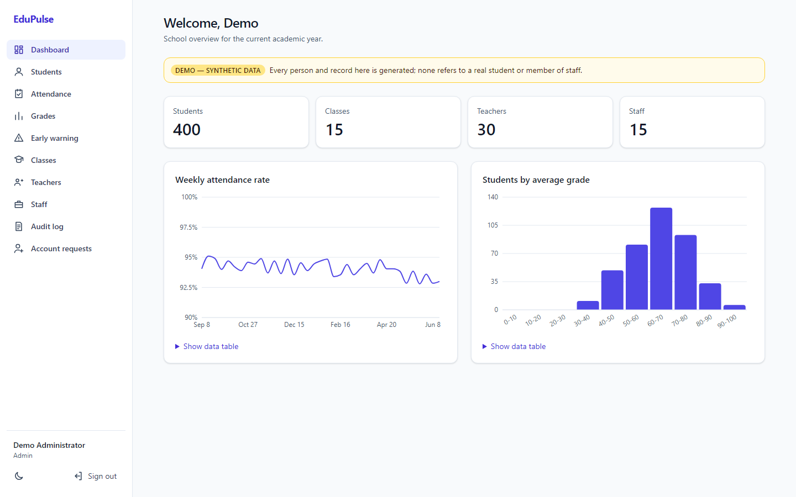 | 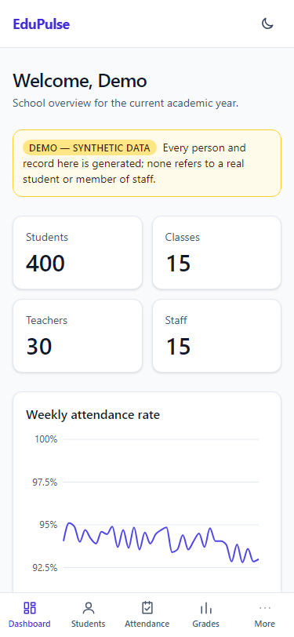 |
| 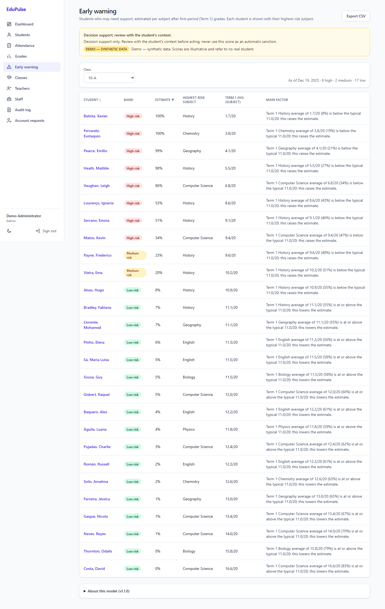 | 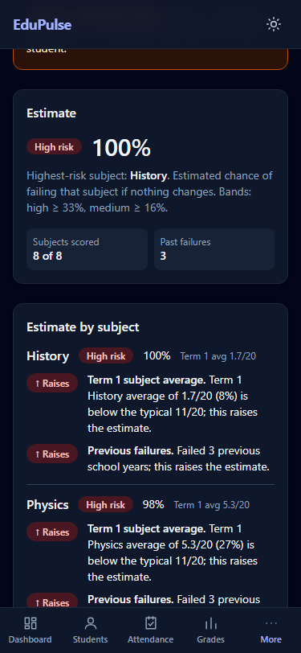 |
| 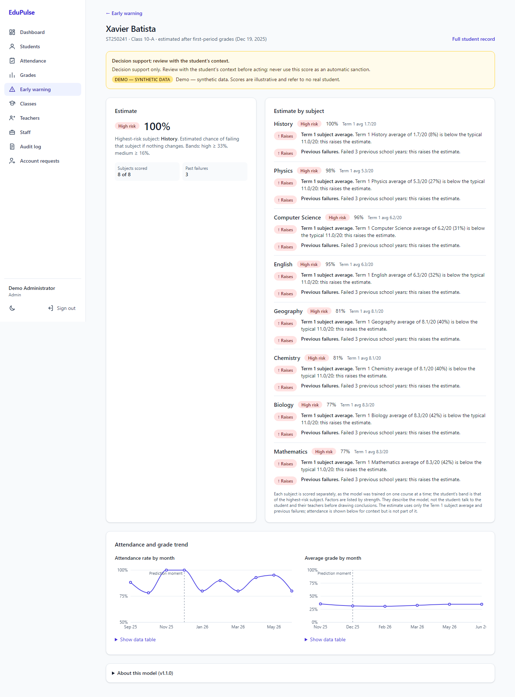 | 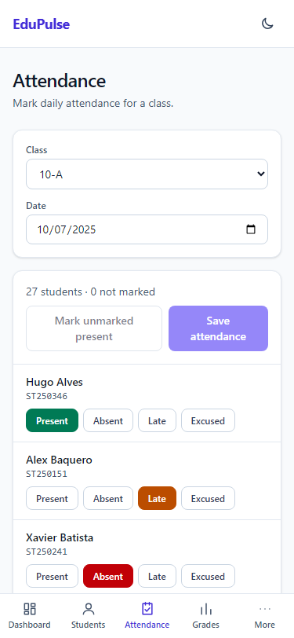 |
| 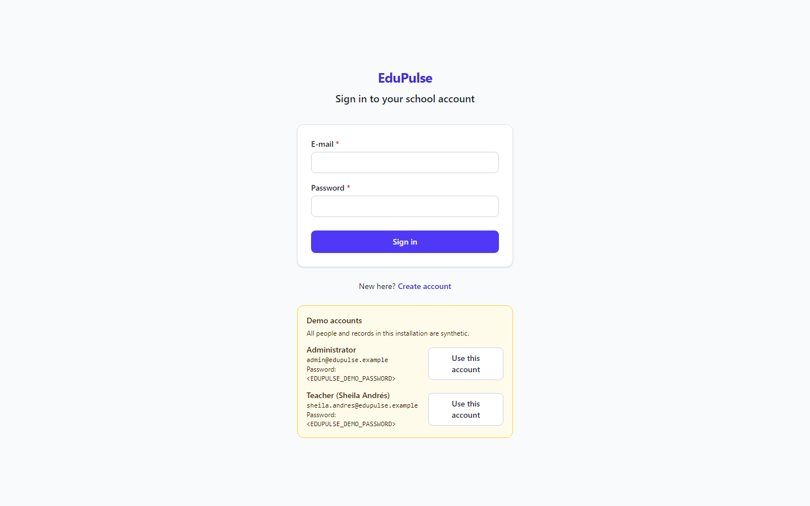 | 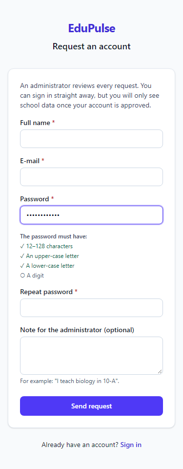 |
| 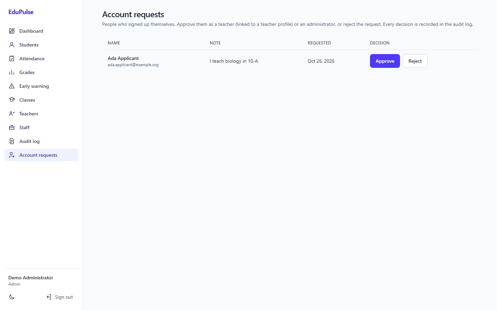 | 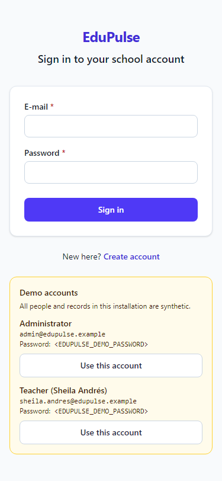 |

More in [`docs/screenshots/`](docs/screenshots/) (students, grades, dark mode). The screenshots replace the real demo password with a placeholder.

## Features

- **People and classes:** students, teachers, non-teaching staff, classes/sections, subjects
  and teaching assignments; search, filters, sorting and pagination; CSV import (validated
  first, per-row error report, all-or-nothing) and formula-safe CSV export.
- **Daily attendance** marked per class in one screen; **grade entry** per assessment with
  limits enforced.
- **Dashboard:** counts, weekly attendance trend, grade distribution (each chart has a data-table
  view).
- **Early warning:** per-class risk list (sortable), per-student panel with risk band, the
  factors behind it, attendance and grade trends with the prediction moment marked; CSV export.
  Each subject is scored separately (the model's training unit is one course); a student's band
  is their highest-risk subject. The estimate uses only the Term 1 subject average and previous
  failures.
- **Roles:** administrators see everything; teachers see only their own classes and students
  and can change grades only for subjects they teach.
- **Accounts:** self sign-up with administrator approval (pending accounts see no data);
  approvals and rejections are audit-logged.
- **Security:** argon2 passwords, short-lived JWT access tokens + rotating httpOnly refresh
  cookie, login and sign-up rate limiting, audit log for risk scores and account decisions,
  strict security headers.
- **Responsive and accessible:** 360 px to desktop, keyboard navigable, light/dark mode,
  WCAG AA contrast (checked with axe on every screen).

## Quickstart (Docker)

Requirements: Docker with Compose.

```bash
cp .env.example .env
# Edit .env: set POSTGRES_PASSWORD, EDUPULSE_JWT_SECRET (32+ random characters) and
# EDUPULSE_DEMO_PASSWORD (12+ characters with upper- and lower-case letters and a digit).
docker compose up --build -d
docker compose exec api python -m app.seed      # load SYNTHETIC demo data
```

- Web app: <http://localhost:8088>
- API documentation (OpenAPI / Swagger UI): <http://localhost:8000/api/v1/docs> (ReDoc at
  `/api/v1/redoc`)
- Health: `/api/v1/health` (liveness), `/api/v1/ready` (database + model)

### Sign in: create an account or use a demo account

- **Use a demo account.** In demo mode the login page shows a *Demo accounts* box with an
  administrator and a teacher; *Use this account* fills in the form. Their password is the
  `EDUPULSE_DEMO_PASSWORD` you set in `.env`.
- **Create an account.** *Create account* on the login page sends a request. The new account
  can sign in at once but only sees a *Waiting for approval* page until an administrator
  approves it under **Account requests** — as a teacher (linked to a teacher profile, so it
  sees exactly that teacher's classes) or as an administrator — or rejects it.

| Role | E-mail | Password |
|---|---|---|
| Administrator | `admin@edupulse.example` | the `EDUPULSE_DEMO_PASSWORD` you set in `.env` |
| Teacher | shown on the login page; any teacher's e-mail from the Teachers page also works, e.g. `sheila.andres@edupulse.example` (TCH001) | same |

These accounts exist only in the demo database created by the seed script. Do not reuse the
demo password anywhere else. For a real installation set `EDUPULSE_DEMO_MODE=false` and leave
`EDUPULSE_DEMO_PASSWORD` unset for the API: the login page then never shows any account.

## Architecture

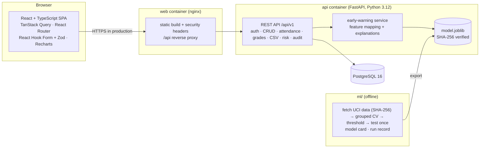

| Path | Contents |
|---|---|
| [`backend/`](backend/) | FastAPI, SQLAlchemy 2, Alembic migrations, Pydantic v2, pytest |
| [`frontend/`](frontend/) | React 19 + Vite + Tailwind, Vitest, Playwright (e2e, axe, screenshots), Lighthouse script |
| [`ml/`](ml/) | dataset fetch, training/evaluation pipeline, run record, reproduction check |
| [`docs/`](docs/) | [model card](docs/model_card.md), [ML case study](docs/case_study.md), [data model](docs/data_model.md), [security](docs/security.md), process records |

## The early-warning model (summary)

Numbers from [`ml/reports/run_record.md`](ml/reports/run_record.md) (reproduced in CI):

| | |
|---|---|
| Data | UCI Student Performance (Cortez & Silva, 2008; CC BY 4.0): 1,044 course records, 662 students, 22.0 % fail |
| Prediction moment | After first-period grades (end of Term 1); later grades and whole-year absences never used |
| Inputs | Term 1 average in one subject and previous-year failures only (no attendance, sex, age or family/socio-economic data); each (student, subject) pair is scored |
| Model | Logistic regression v1.1.0, chosen over gradient boosting by a pre-registered rule; new holdout after review T-R2 |
| Cross-validated average precision | 0.769 ± 0.062 (dummy baseline 0.220 ± 0.002) |
| Held-out test (scored once) | AP **0.845** [95 % CI 0.740–0.924], ROC AUC 0.953 [0.924–0.977] |
| At the "high risk" threshold (0.327) | recall 0.891 [0.792–0.976], precision 0.651 [0.527–0.767] |
| Importance (test set) | Term 1 average 99.2 %, previous failures 0.8 % |
| Without any grade (failures only; not served) | test AP 0.414 [0.290–0.565]; flags every student at 80 % recall |
| Fairness check (sex, not an input) | test recall F 0.840 [0.680–0.966] (n=101, 25 fails) vs M 0.952 [0.833–1.000] (n=108, 21 fails): inconclusive, not evidence of fairness |

Read the [model card](docs/model_card.md) before relying on any score, and the
[case study](docs/case_study.md) for how it was built.

## Development

```bash
# Backend (Python 3.12 via uv)
cd backend && uv sync && uv run pytest --cov
# Run against the compose database (see .env.example for EDUPULSE_DATABASE_URL)
uv run alembic upgrade head && uv run uvicorn app.main:app --reload

# Frontend
cd frontend && npm ci && npm run dev          # http://localhost:5173, proxies /api to :8000
npm test && npm run build
E2E_PASSWORD=... npx playwright test          # e2e + accessibility at 375 px and 1440 px

# ML
cd ml && uv sync && uv run python -m edupulse_ml.train && uv run python -m edupulse_ml.export

# Everything the milestone gate runs
scripts/gate.sh --e2e
```

CI (GitHub Actions) runs lint, types and tests for all three projects, migrations and seeding on
PostgreSQL 16, the ML reproduction check, Playwright with axe, and dependency audits.

## Limitations

- The model reflects 2005–06 Portuguese data (two courses); EduPulse scores its own subjects
  with it, one subject at a time. Re-validate locally before real use.
- Only one academic year is active at a time; there is no year-rollover workflow.
- The login rate limiter is per process; multiple API replicas need a shared store.
- No HTTPS termination in the compose setup; enable `EDUPULSE_HSTS` behind TLS.
- Lighthouse (mobile) performance is 96–97 on most screens but 76–79 on the dashboard because of
  chart rendering cost; lazy loading and viewport deferral were measured (best median 84) and,
  not reaching 90, were not kept (see `docs/process/PROJECT_STATUS.md`).
- Not included: parent/student portals, messaging, payments, multi-school tenancy.

## Licence and attribution

Code: [MIT](LICENSE) © 2026 Jaswant Raj. Training data: UCI Student Performance dataset,
CC BY 4.0 — see [NOTICE.md](NOTICE.md).
