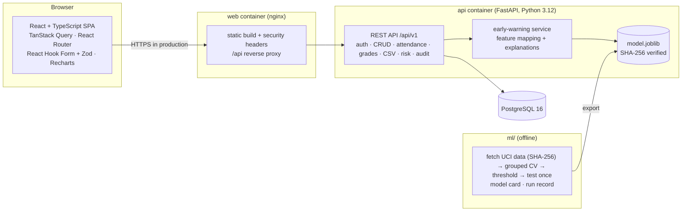

# EduPulse

EduPulse is a school management platform — students, teachers, staff, classes, daily
attendance and grades — with an **explainable early-warning module** that helps staff notice,
after the first term, which students may be heading towards failing the year.

The early warning is **decision support**: every score comes with its reasons in plain language,
a visible reminder to review it with the student's context, and an audit trail. It is never an
automatic sanction.

> **Demo data only.** Everything this repository loads into the database is synthetic
> (generated with a fixed seed). The early-warning model was trained on a public research
> dataset from Portuguese secondary schools and must be re-validated before any real use.

| Desktop | Mobile (375 px) |
|---|---|
|  |  |
|  |  |
|  |  |

More in [`docs/screenshots/`](docs/screenshots/) (login, students, grades, dark mode).

## Features

- **People and classes:** students, teachers, non-teaching staff, classes/sections, subjects
  and teaching assignments; search, filters, sorting and pagination; CSV import (validated
  first, per-row error report, all-or-nothing) and formula-safe CSV export.
- **Daily attendance** marked per class in one screen; **grade entry** per assessment with
  limits enforced.
- **Dashboard:** counts, weekly attendance trend, grade distribution (each chart has a data-table
  view).
- **Early warning:** per-class risk list (sortable), per-student panel with risk band, the
  factors behind it, attendance and grade trends with the prediction moment marked; CSV export.
- **Roles:** administrators see everything; teachers see only their own classes and students
  and can change grades only for subjects they teach.
- **Security:** argon2 passwords, short-lived JWT access tokens + rotating httpOnly refresh
  cookie, login rate limiting, audit log for risk scores, strict security headers.
- **Responsive and accessible:** 360 px to desktop, keyboard navigable, light/dark mode,
  WCAG AA contrast (checked with axe on every screen).

## Quickstart (Docker)

Requirements: Docker with Compose.

```bash
cp .env.example .env
# Edit .env: set POSTGRES_PASSWORD, EDUPULSE_JWT_SECRET (32+ random characters) and
# EDUPULSE_DEMO_PASSWORD (12+ characters with upper- and lower-case letters and a digit).
docker compose up --build -d
docker compose exec api python -m app.seed      # load SYNTHETIC demo data
```

- Web app: <http://localhost:8088>
- API documentation (OpenAPI / Swagger UI): <http://localhost:8000/api/v1/docs> (ReDoc at
  `/api/v1/redoc`)
- Health: `/api/v1/health` (liveness), `/api/v1/ready` (database + model)

### Demo logins (synthetic data, demo only)

| Role | E-mail | Password |
|---|---|---|
| Administrator | `admin@edupulse.example` | the `EDUPULSE_DEMO_PASSWORD` you set in `.env` |
| Teacher | any teacher's e-mail from the Teachers page, e.g. `sheila.andres@edupulse.example` (TCH001) | same |

These accounts exist only in the demo database created by the seed script. Do not reuse the
demo password anywhere else.

## Architecture



| Path | Contents |
|---|---|
| [`backend/`](backend/) | FastAPI, SQLAlchemy 2, Alembic migrations, Pydantic v2, pytest |
| [`frontend/`](frontend/) | React 19 + Vite + Tailwind, Vitest, Playwright (e2e, axe, screenshots), Lighthouse script |
| [`ml/`](ml/) | dataset fetch, training/evaluation pipeline, run record, reproduction check |
| [`docs/`](docs/) | [model card](docs/model_card.md), [ML case study](docs/case_study.md), [data model](docs/data_model.md), [security](docs/security.md), process records |

## The early-warning model (summary)

Numbers from [`ml/reports/run_record.md`](ml/reports/run_record.md) (reproduced in CI):

| | |
|---|---|
| Data | UCI Student Performance (Cortez & Silva, 2008; CC BY 4.0): 1,044 course records, 662 students, 22.0 % fail |
| Prediction moment | After first-period grades (end of Term 1); later grades never used |
| Inputs | Term 1 average, absences, previous-year failures (no sex, age or family/socio-economic data) |
| Model | Logistic regression, chosen over gradient boosting by a pre-declared rule |
| Cross-validated average precision | 0.803 ± 0.057 (dummy baseline 0.220 ± 0.002) |
| Held-out test (scored once) | AP **0.817** [95 % CI 0.705–0.901], ROC AUC 0.936 [0.900–0.966] |
| At the "high risk" threshold (0.315) | recall 0.804 [0.674–0.915], precision 0.627 [0.500–0.740] |
| Fairness check (sex, not an input) | recall F 0.833 [0.682, 0.952] (n=128, 30 fails) vs M 0.750 [0.500, 0.945] (n=81, 16 fails): inconclusive, not evidence of fairness |
| Without period grades (pre-term variant, not served) | test AP 0.489 [0.361, 0.646] |

Read the [model card](docs/model_card.md) before relying on any score, and the
[case study](docs/case_study.md) for how it was built.

## Development

```bash
# Backend (Python 3.12 via uv)
cd backend && uv sync && uv run pytest --cov
# Run against the compose database (see .env.example for EDUPULSE_DATABASE_URL)
uv run alembic upgrade head && uv run uvicorn app.main:app --reload

# Frontend
cd frontend && npm ci && npm run dev          # http://localhost:5173, proxies /api to :8000
npm test && npm run build
E2E_PASSWORD=... npx playwright test          # e2e + accessibility at 375 px and 1440 px

# ML
cd ml && uv sync && uv run python -m edupulse_ml.train && uv run python -m edupulse_ml.export

# Everything the milestone gate runs
scripts/gate.sh --e2e
```

CI (GitHub Actions) runs lint, types and tests for all three projects, migrations and seeding on
PostgreSQL 16, the ML reproduction check, Playwright with axe, and dependency audits.

## Limitations

- The model reflects 2005–06 Portuguese data; EduPulse's inputs are computed slightly
  differently (multi-subject average, projected absences). Re-validate locally before real use.
- Only one academic year is active at a time; there is no year-rollover workflow.
- The login rate limiter is per process; multiple API replicas need a shared store.
- No HTTPS termination in the compose setup; enable `EDUPULSE_HSTS` behind TLS.
- Lighthouse (mobile) performance is 96–97 on most screens but 76–79 on the dashboard because of
  chart rendering cost; lazy loading and viewport deferral were measured (best median 84) and,
  not reaching 90, were not kept (see `docs/process/PROJECT_STATUS.md`).
- Not included: parent/student portals, messaging, payments, multi-school tenancy.

## Licence and attribution

Code: [MIT](LICENSE) © 2026 Jaswant Raj. Training data: UCI Student Performance dataset,
CC BY 4.0 — see [NOTICE.md](NOTICE.md).
