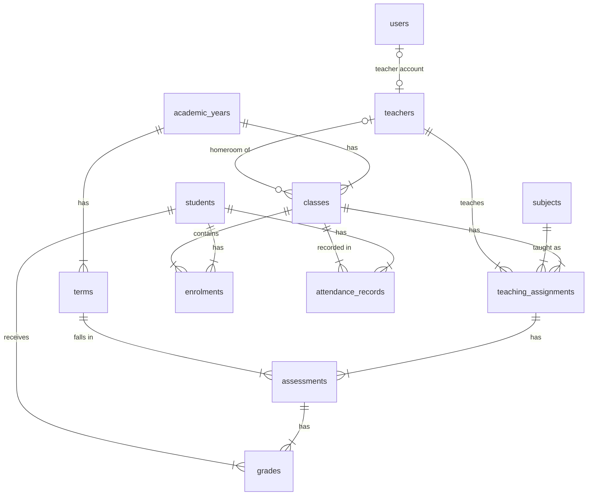

# Data model

All tables are created by Alembic migrations in `backend/alembic/versions/`. Constraint names
follow a fixed naming convention (`backend/app/db/base.py`) so migrations are stable.

| Table | Purpose | Key constraints |
|-------|---------|-----------------|
| `users` | Login accounts (`admin`, `teacher`); `status` pending / active / rejected / disabled; sign-up note and review decision | unique e-mail; an active account has a role and an active teacher account links to a `teachers` row (CHECK); pending accounts have no role |
| `teachers`, `staff` | Employee profiles | unique employee number and e-mail |
| `students` | Student profiles | unique student number; `prior_failures` 0–3 (CHECK); status enum |
| `academic_years`, `terms` | Calendar | start < end (CHECK); term number unique per year |
| `subjects` | Subject catalogue | unique code and name |
| `classes` | A class/section in one year (e.g. `10-B`) | unique (year, grade, section) |
| `teaching_assignments` | Teacher teaches subject to class | unique (class, subject) |
| `enrolments` | Student belongs to class | unique (student, year); composite FK (class, year) keeps the year consistent |
| `attendance_records` | Daily attendance | unique (student, date); index (class, date) |
| `assessments` | Graded work for an assignment in a term | max score and weight > 0 (CHECK) |
| `grades` | A student's score on an assessment | unique (assessment, student); score ≥ 0 (CHECK); score ≤ max enforced in the service layer |

## Access model

A teacher "owns" a class when they are its homeroom teacher or hold any teaching assignment in
it. Teacher-scoped API queries filter through that relation; admins see everything.

## Synthetic demo data

`python -m app.seed` generates one academic year (2025-2026, three terms) with 400 students,
30 teachers, 15 staff, 15 classes (grades 10–12, sections A–E), 8 subjects, daily attendance and
two assessments per subject per term. **All of it is synthetic**: Faker names with a fixed seed,
`@edupulse.example` e-mail addresses (reserved domain) and fictional `+1-555-01xx` phone numbers.
Hidden per-student traits (never stored) keep grades and attendance internally consistent so the
demo dashboards and the early-warning scores have realistic spread.
